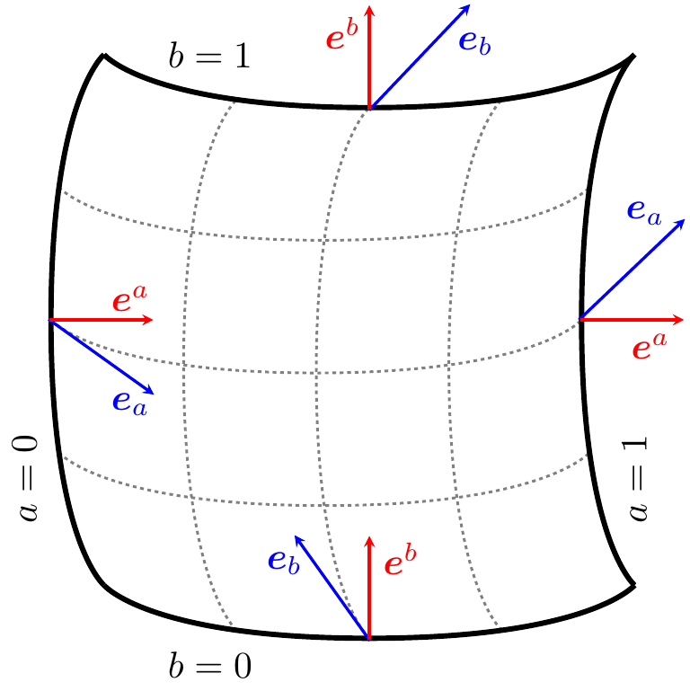

.. ------------------------------------------------------------------------------
     (c) Crown copyright Met Office. All rights reserved.
     The file LICENCE, distributed with this code, contains details of the terms
     under which the code may be used.
   ------------------------------------------------------------------------------

.. _coordinates_and_vectors_coordinate_systems:

Coordinate Systems on the Sphere
================================

This page covers the geometric definitions used in GungHo for
Cartesian, spherical polar and equiangular cubed-sphere coordinates, and then
describes how these systems are combined with mesh rotation and stretching.

Notation and Definitions
------------------------

Let :math:`\mathbf{X}` denote the field of position vectors. A general
coordinate system :math:`f` is defined through a set of coordinate variables
:math:`\chi^{(f)} = \{\chi_i^{(f)} : i \in (1, \dots, N)\}`.

The mapping from a general coordinate system to geocentric Cartesian
coordinates :math:`\chi^{(XYZ)} = \{X, Y, Z\}` is written as
:math:`\chi^{(XYZ)} = \mathcal{F}[\chi^{(f)}]`, with components

.. math::

    \chi_i^{(XYZ)} = F_i(\chi^{(f)}), \qquad
    \chi_i^{(f)} = F_i^{-1}(\chi^{(XYZ)}).

The operator :math:`\mathcal{F}` is generally nonlinear and may not
be simply represented by a matrix.

For each coordinate :math:`\chi_i^{(f)}`:

* the primal basis vector is defined by

  .. math::

      \mathbf{e}_{(f_i)} = \frac{\partial \mathbf{X}}{\partial \chi_i^{(f)}};

* the dual basis vector is defined by

  .. math::

      \mathbf{e}^{(f_i)} = \nabla \chi_i^{(f)}.

    Primal and dual basis vectors for a generic non-orthogonal coordinate
    system.

The components of the basis vectors relate to the transformation
:math:`\mathcal{F}` as

.. math::

    \left[\mathbf{e}_{(f_i)}\right]_j = \frac{\partial F_j}{\partial \chi_i^{(f)}}, \qquad
    \left[\mathbf{e}^{(f_i)}\right]_j = \frac{\partial F_i^{-1}}{\partial \chi_j^{(XYZ)}}.

The metric tensor :math:`g^{(f)}` is the symmetric rank-2 tensor defined by

.. math::

    g^{(f)}_{ij} = \mathbf{e}_{(f_i)} \cdot \mathbf{e}_{(f_j)}.

It is used to define line and volume elements:

.. math::

    \mathrm{d}l^{(f)} = \sqrt{\sum_{ij} g_{ij}\,\mathrm{d}\chi_i^{(f)}\,\mathrm{d}\chi_j^{(f)}}, \qquad
    \mathrm{d}V^{(f)} = \sqrt{\det(g)}\prod_i \mathrm{d}\chi_i^{(f)}.

The Jacobian for a transform from coordinates :math:`f` to :math:`h` is

.. math::

    J_{ij}^{(h,f)} = \frac{\partial \chi_i^{(h)}}{\partial \chi_j^{(f)}}.

If :math:`h` is the Cartesian system, then the Jacobian columns are the primal
basis vectors:

.. math::

    J_{ij}^{(XYZ,f)} = \frac{\partial \chi_i^{(XYZ)}}{\partial \chi_j^{(f)}} =
    \left[\mathbf{e}_{(f_j)}\right]_i.

This gives the compact relation

.. math::

    g^{(f)} = \left(\mathbf{J}^{(XYZ,f)}\right)^T \mathbf{J}^{(XYZ,f)}.

Native Coordinates and Mesh Transformations
-------------------------------------------

The native coordinates of a mesh are the coordinates that exactly describe the
coordinate lines used to create the mesh. In this documentation, native coordinates
are denoted with a dot, for example :math:`\dot{\chi}^{(f)}`.

In general, the mesh used in GungHo may be rotated and stretched from the
basic longitude-latitude or equiangular cubed-sphere mesh. These operations
occur in the following order:

1. the mesh is stretched by a factor :math:`s` towards the North Pole;
2. the mesh is rotated by an angle :math:`\vartheta` about the original North
   Pole;
3. the North Pole of the mesh is rotated to a new location, with longitude
   :math:`\lambda_N` and latitude :math:`\varphi_N`.

The full mapping can be written as

.. math::

    \chi^{(XYZ)} = \mathcal{R}\,\mathcal{S}\,\mathcal{F}[\dot{\chi}^{(f)}],

with inverse

.. math::

    \dot{\chi}^{(f)} = \mathcal{F}^{-1}\,\mathcal{S}^{-1}\,\mathcal{R}^{-1}[\chi^{(XYZ)}].

Geocentric Cartesian Coordinates
--------------------------------

The geocentric Cartesian coordinate system is defined by :math:`X`,
:math:`Y` and :math:`Z`, which measure physical distance from the origin in
three orthogonal components. The coordinates obey the right-hand rule and are
usually taken with the origin at the centre of the sphere.

The unit basis vectors are

.. math::

    \mathbf{e}_X = \mathbf{e}^X = \begin{bmatrix}1\\0\\0\end{bmatrix}, \qquad
    \mathbf{e}_Y = \mathbf{e}^Y = \begin{bmatrix}0\\1\\0\end{bmatrix}, \qquad
    \mathbf{e}_Z = \mathbf{e}^Z = \begin{bmatrix}0\\0\\1\end{bmatrix}.

For Cartesian coordinates, primal and dual basis vectors coincide and the
Jacobian is the identity matrix.