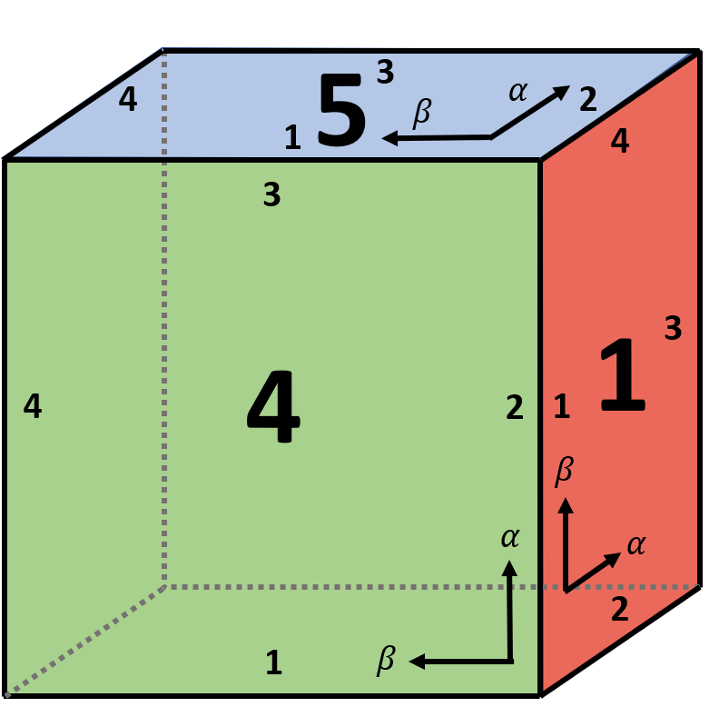
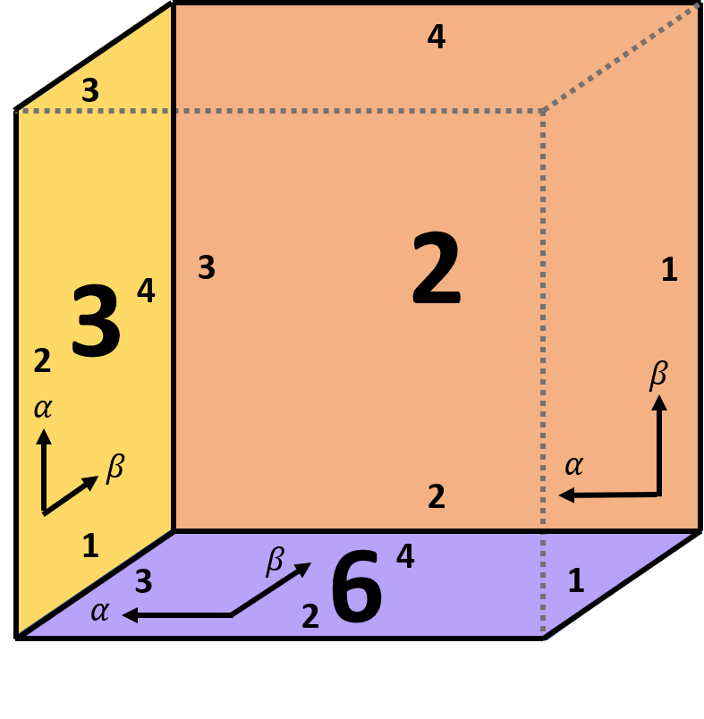
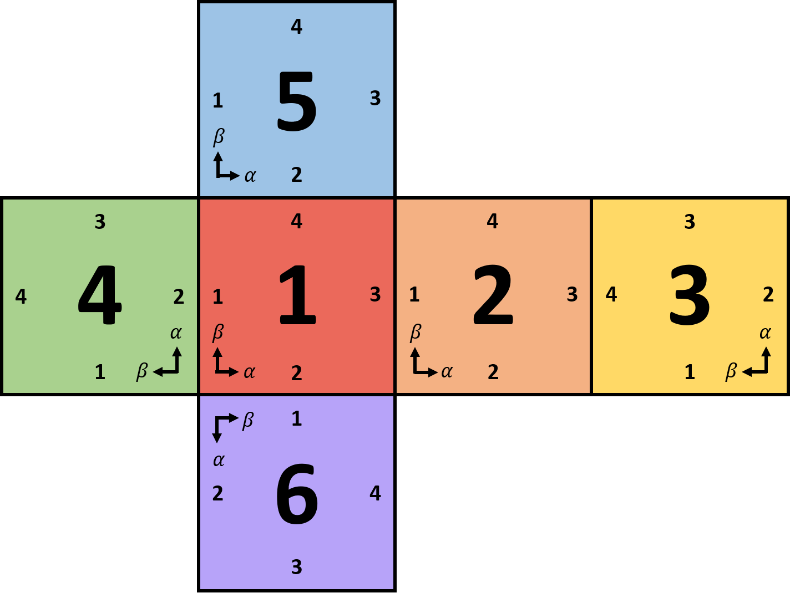

.. ------------------------------------------------------------------------------
     (c) Crown copyright Met Office. All rights reserved.
     The file LICENCE, distributed with this code, contains details of the terms
     under which the code may be used.
   ------------------------------------------------------------------------------

.. _coordinates_and_vectors_equiangular_cubed_sphere_coordinates:

Equiangular Cubed-Sphere Coordinates
====================================

We consider the native coordinates :math:`(\alpha, \beta, r)` for the
:math:`p`-th cubed-sphere panel. These coordinates are related to panel
Cartesian coordinates :math:`(X_p, Y_p, Z_p)` via

.. math::

    \alpha_p = \tan^{-1}\left(\frac{Y_p}{X_p}\right), \qquad
    \beta_p = \tan^{-1}\left(\frac{Z_p}{X_p}\right), \qquad
    r = \sqrt{X_p^2 + Y_p^2 + Z_p^2},

and conversely

.. math::

    X_p = \frac{r}{\varrho_p}, \qquad
    Y_p = \frac{r\tan\alpha_p}{\varrho_p}, \qquad
    Z_p = \frac{r\tan\beta_p}{\varrho_p},

where

.. math::

    \varrho_p = \sqrt{1 + \tan^2\alpha_p + \tan^2\beta_p}.

The numbering and orientation of the panels are shown below.

    Front-facing cubed-sphere panels.

    Back-facing cubed-sphere panels.

    Unfolded cubed-sphere arrangement and panel orientation.

The panel coordinates are obtained by first rotating the geocentric Cartesian
coordinates using a panel-specific matrix :math:`\mathbf{P}_p`:

.. math::

    \begin{bmatrix}X_p\\Y_p\\Z_p\end{bmatrix} =
    \mathbf{P}_p\begin{bmatrix}X\\Y\\Z\end{bmatrix}.

The rotation matrices are:

.. math::

    \mathbf{P}_1 = \begin{bmatrix}1&0&0\\0&1&0\\0&0&1\end{bmatrix}, \quad
    \mathbf{P}_2 = \begin{bmatrix}0&-1&0\\1&0&0\\0&0&1\end{bmatrix}, \quad
    \mathbf{P}_3 = \begin{bmatrix}-1&0&0\\0&0&1\\0&1&0\end{bmatrix},

.. math::

    \mathbf{P}_4 = \begin{bmatrix}0&0&-1\\-1&0&0\\0&1&0\end{bmatrix}, \quad
    \mathbf{P}_5 = \begin{bmatrix}0&0&-1\\0&1&0\\1&0&0\end{bmatrix}, \quad
    \mathbf{P}_6 = \begin{bmatrix}0&-1&0\\0&0&1\\-1&0&0\end{bmatrix}.

The inverse matrices are

.. math::

    \mathbf{P}_1^{-1} = \begin{bmatrix}1&0&0\\0&1&0\\0&0&1\end{bmatrix}, \quad
    \mathbf{P}_2^{-1} = \begin{bmatrix}0&1&0\\-1&0&0\\0&0&1\end{bmatrix}, \quad
    \mathbf{P}_3^{-1} = \begin{bmatrix}-1&0&0\\0&0&1\\0&1&0\end{bmatrix},

.. math::

    \mathbf{P}_4^{-1} = \begin{bmatrix}0&-1&0\\0&0&1\\-1&0&0\end{bmatrix}, \quad
    \mathbf{P}_5^{-1} = \begin{bmatrix}0&0&1\\0&1&0\\-1&0&0\end{bmatrix}, \quad
    \mathbf{P}_6^{-1} = \begin{bmatrix}0&0&-1\\-1&0&0\\0&1&0\end{bmatrix}.

Primal and Dual Basis Vectors
-----------------------------

The primal basis vectors for panel 1 of the cubed sphere are

.. math::

    \mathbf{e}_\alpha = \frac{r\sec^2\alpha}{\varrho^3}
    \begin{bmatrix}-\tan\alpha\\ \sec^2\beta\\ -\tan\alpha\tan\beta\end{bmatrix}, \qquad
    \mathbf{e}_\beta = \frac{r\sec^2\beta}{\varrho^3}
    \begin{bmatrix}-\tan\beta\\ -\tan\alpha\tan\beta\\ \sec^2\alpha\end{bmatrix}, \qquad
    \mathbf{e}_r = \frac{1}{\varrho}
    \begin{bmatrix}1\\ \tan\alpha\\ \tan\beta\end{bmatrix}.

The corresponding unit primal vectors are

.. math::

    \widehat{\mathbf{e}}_\alpha = \frac{1}{\varrho}
    \begin{bmatrix}-\tan\alpha\cos\beta\\ \sec\beta\\ -\tan\alpha\sin\beta\end{bmatrix}, \qquad
    \widehat{\mathbf{e}}_\beta = \frac{1}{\varrho}
    \begin{bmatrix}-\tan\beta\cos\alpha\\ -\tan\beta\sin\alpha\\ \sec\alpha\end{bmatrix}, \qquad
    \widehat{\mathbf{e}}_r = \frac{1}{\varrho}
    \begin{bmatrix}1\\ \tan\alpha\\ \tan\beta\end{bmatrix}.

The dual basis vectors are

.. math::

    \mathbf{e}^\alpha = \frac{\varrho\cos^2\alpha}{r}
    \begin{bmatrix}-\tan\alpha\\ 1\\ 0\end{bmatrix}, \qquad
    \mathbf{e}^\beta = \frac{\varrho\cos^2\beta}{r}
    \begin{bmatrix}-\tan\beta\\ 0\\ 1\end{bmatrix}, \qquad
    \mathbf{e}^r = \frac{1}{\varrho}
    \begin{bmatrix}1\\ \tan\alpha\\ \tan\beta\end{bmatrix}.

The unit dual vectors are

.. math::

    \widehat{\mathbf{e}}^{\,\alpha} = \begin{bmatrix}-\sin\alpha\\ \cos\alpha\\ 0\end{bmatrix}, \qquad
    \widehat{\mathbf{e}}^{\,\beta} = \begin{bmatrix}-\sin\beta\\ 0\\ \cos\beta\end{bmatrix}, \qquad
    \widehat{\mathbf{e}}^{\,r} = \frac{1}{\varrho}
    \begin{bmatrix}1\\ \tan\alpha\\ \tan\beta\end{bmatrix}.

The cubed-sphere Jacobian from :math:`(\alpha,\beta,r,p)` to Cartesian
coordinates may be written as

.. math::

    \mathbf{J}^{(XYZ,\alpha\beta rp)} = \frac{r}{\varrho^3}
    \begin{bmatrix}
    -\tan\alpha(1+\tan^2\alpha) & -\tan\beta(1+\tan^2\beta) & \varrho^2/r \\
    (1+\tan^2\beta)(1+\tan^2\alpha) & -\tan\alpha\tan\beta(1+\tan^2\beta) & \varrho^2\tan\alpha/r \\
    -\tan\alpha\tan\beta(1+\tan^2\alpha) & (1+\tan^2\alpha)(1+\tan^2\beta) & \varrho^2\tan\beta/r
    \end{bmatrix}.
