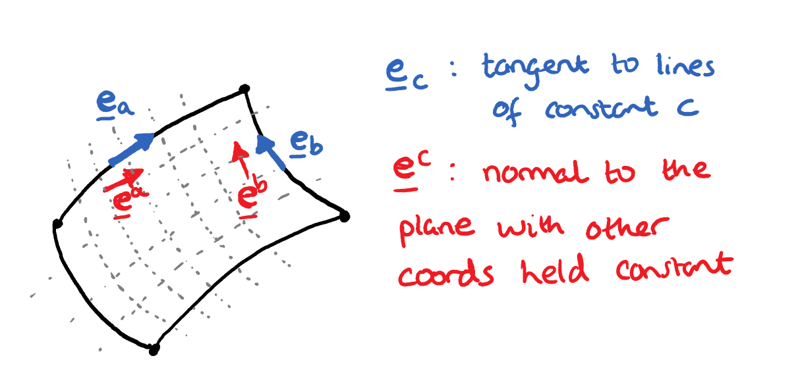
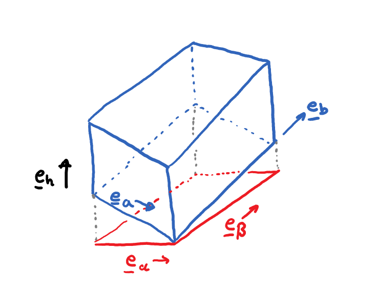

.. ------------------------------------------------------------------------------
     (c) Crown copyright Met Office. All rights reserved.
     The file LICENCE, distributed with this code, contains details of the terms
     under which the code may be used.
   ------------------------------------------------------------------------------

.. _coordinates_and_vectors_vector_components:

Non-Orthogonal Wind Components
==============================

The GungHo dynamical core uses coordinates that are not orthogonal: the
cells of a cubed-sphere mesh are not rectangles, and in terrain-following
coordinates the coordinate lines are not perpendicular to each other.
The numbers stored in a wind field are therefore *not* the familiar
eastward, northward and upward components of the wind. This page explains
the basis and dual-basis conventions needed to interpret them, and shows how
they relate to ordinary orthogonal (e.g. horizontal and vertical) components.

Throughout, :math:`\boldsymbol{\chi}` denotes the position vector, and
:math:`(a, b, c)` a general set of coordinates. The vector :math:`\mathbf{v}`
is a wind (or any other vector field).

The difference between basis vectors and dual basis vectors
-----------------------------------------------------------

For a coordinate :math:`a`, the basis vector is tangent to coordinate lines:

.. math::

    \mathbf{e}_a = \frac{\partial\boldsymbol{\chi}}{\partial a}.

The dual basis vector is normal to the surface that keeps the other
coordinates constant:

.. math::

    \mathbf{e}^a = \nabla a.

Dual basis vectors can only be defined once the whole basis has been chosen.
The two sets are related by

.. math::

    \mathbf{e}^a\cdot\mathbf{e}_b = \delta^a_b,

so that each dual basis vector is perpendicular to all basis vectors except
its partner. In terms of the Jacobian matrix :math:`J` of the mapping from the
coordinates to Cartesian space, whose columns are the basis vectors
:math:`\mathbf{e}_a`, the dual basis vectors are the rows of :math:`J^{-1}`.
For an orthogonal coordinate system the two sets point in the same direction,
and differ only in their lengths.

    Difference between basis vectors and dual basis vectors in two dimensions.

Contravariant and covariant components
--------------------------------------

When writing a vector field :math:`\mathbf{v}` through components, it is
typical to use either

.. math::

    \mathbf{v} = \sum_i v^i\,\widehat{\mathbf{e}}_i

with contravariant components and basis vectors, or

.. math::

    \mathbf{v} = \sum_i v_i\,\widehat{\mathbf{e}}^i

with covariant components and dual basis vectors.

The components are found by taking inner products with the *other* set of
vectors:

.. math::

    v^i = \mathbf{v}\cdot\mathbf{e}^i, \qquad v_i = \mathbf{v}\cdot\mathbf{e}_i.

So a contravariant component measures how much of the vector is "along" a
coordinate line, whereas a covariant component is the projection of the vector
onto that line. In an orthogonal coordinate system these coincide (up to
scaling by the lengths of the basis vectors), but in a non-orthogonal system
they differ.

Computational values of W1 and W2 fields
----------------------------------------

The finite element fields in GungHo store *computational* values, which are
the degrees of freedom (DoFs) of the field. For the lowest-order spaces these
have a simple geometric meaning:

* The computational value at a face :math:`\Gamma` of a :math:`\mathbb{W}_2`
  field :math:`\mathbf{u}` corresponds to

  .. math::

      \int_\Gamma \mathbf{u}\cdot\widehat{\mathbf{n}}\,\mathrm{d}S,

  where :math:`\widehat{\mathbf{n}}` is the unit normal to the face.

* The computational value at an edge :math:`\gamma` of a :math:`\mathbb{W}_1`
  field :math:`\boldsymbol{\xi}` corresponds to

  .. math::

      \int_\gamma \boldsymbol{\xi}\cdot\widehat{\mathbf{t}}\,\mathrm{d}l,

  where :math:`\widehat{\mathbf{t}}` is the unit tangent to the edge.

These can be related to the basis vectors above. Let :math:`J` be the Jacobian
of the mapping from the reference element (with coordinates
:math:`\hat{\boldsymbol{\chi}}`, in which every cell is a unit cube) to physical
space, so that the columns of :math:`J` are the basis vectors
:math:`\mathbf{e}_i = \partial\boldsymbol{\chi}/\partial\hat{\chi}_i`, and
let :math:`\det J` be its determinant.

* The face :math:`\hat{\chi}_i=\mathrm{const}` has area vector
  :math:`\widehat{\mathbf{n}}\,\mathrm{d}S = \mathbf{e}_j\times\mathbf{e}_k\,
  \mathrm{d}\hat{\chi}_j\mathrm{d}\hat{\chi}_k`, and
  :math:`\mathbf{e}_j\times\mathbf{e}_k = \det J\;\mathbf{e}^i`. Hence the
  :math:`\mathbb{W}_2` DoF on this face is, to lowest order,

  .. math::

      \hat{u}_i = \det J\;\mathbf{u}\cdot\mathbf{e}^i = \det J\; u^i,

  i.e. the :math:`\mathbb{W}_2` DoFs are the **contravariant components of the
  wind, multiplied by** :math:`\det J`. Inverting this gives the *Piola
  transform* for :math:`\mathbb{W}_2`:

  .. math::

      \mathbf{u} = \frac{1}{\det J}\,J\,\hat{\mathbf{u}}.

* The edge :math:`\hat{\chi}_i` has :math:`\widehat{\mathbf{t}}\,\mathrm{d}l =
  \mathbf{e}_i\,\mathrm{d}\hat{\chi}_i`, so the :math:`\mathbb{W}_1` DoF is

  .. math::

      \hat{\xi}_i = \boldsymbol{\xi}\cdot\mathbf{e}_i = \xi_i,

  i.e. the :math:`\mathbb{W}_1` DoFs are the **covariant components**, and the
  *Piola transform* for :math:`\mathbb{W}_1` is

  .. math::

      \boldsymbol{\xi} = J^{-T}\,\hat{\boldsymbol{\xi}}.

In non-orthogonal geometry, these quantities are therefore naturally tied to
specific basis and dual-basis directions rather than to simple Cartesian
components. On a cubed sphere the same statement holds, with
:math:`J` including the mapping from the equiangular panel coordinates to
global Cartesian coordinates (see
:ref:`coordinates_and_vectors_equiangular_cubed_sphere_coordinates`).

Transport operator
------------------

The transport (advection) operator acting on a scalar :math:`q` is
:math:`\mathbf{u}\cdot\nabla q`. Writing the wind with contravariant
components, :math:`\mathbf{u} = \sum_i u^i\,\mathbf{e}_i`, and using the fact
that :math:`\mathbf{e}_i\cdot\nabla q = \partial q/\partial\hat{\chi}_i` (the
rate of change of :math:`q` along the coordinate line), gives

.. math::

    \mathbf{u}\cdot\nabla q = \sum_i u^i\,\frac{\partial q}{\partial\hat{\chi}_i}.

This is exactly the form needed by a split transport scheme, which computes
differences of :math:`q` along each coordinate line in turn (the derivative
:math:`\partial q/\partial\hat{\chi}_i` is approximated by a difference across
a cell in direction :math:`i`) and multiplies them by the wind through that
coordinate direction. No metric terms are needed to project the wind: the
appropriate wind component is :math:`u^i=\hat{u}_i/\det J`, which is
available directly from the :math:`\mathbb{W}_2` DoF.

For transport in conservative form the factor of :math:`\det J` cancels with
the cell volume:

.. math::

    \nabla\cdot(\mathbf{u}\,q) =
    \frac{1}{\det J}\sum_i\frac{\partial}{\partial\hat{\chi}_i}
    \left(\hat{u}_i\,q\right),

so that the raw :math:`\mathbb{W}_2` values :math:`\hat{u}_i` are the fluxes
through the faces of the cell, with no further conversion required. This is
why the transport scheme can work directly with the :math:`\mathbb{W}_2` field.

Components in non-orthogonal coordinates
----------------------------------------

A physical wind prescribed or diagnosed in terms of horizontal and vertical
components, :math:`(u, w)`, is not the same as the wind stored in the model.
The difference is most easily seen with terrain-following coordinates in a
2D cell.

Consider a 2D cell that follows the terrain, with local slope angle
:math:`\theta`. Four unit vectors are of interest:

* :math:`\widehat{\mathbf{e}}_t`, tangent to the terrain;
* :math:`\widehat{\mathbf{e}}_z`, vertical;
* :math:`\widehat{\mathbf{e}}_x`, horizontal;
* :math:`\widehat{\mathbf{e}}_n`, normal to the terrain.

The pairs :math:`(\widehat{\mathbf{e}}_t, \widehat{\mathbf{e}}_z)` and
:math:`(\widehat{\mathbf{e}}_x, \widehat{\mathbf{e}}_n)` are related by dual
bases:

* for :math:`(\widehat{\mathbf{e}}_t, \widehat{\mathbf{e}}_z)`, the dual
  basis vectors are :math:`\widehat{\mathbf{e}}^t = \widehat{\mathbf{e}}_x`
  and :math:`\widehat{\mathbf{e}}^z = \widehat{\mathbf{e}}_n`;
* for :math:`(\widehat{\mathbf{e}}_x, \widehat{\mathbf{e}}_n)`, the dual
  basis vectors are :math:`\widehat{\mathbf{e}}^x = \widehat{\mathbf{e}}_t`
  and :math:`\widehat{\mathbf{e}}^n = \widehat{\mathbf{e}}_z`.

where :math:`\widehat{\mathbf{e}}_t\cdot\widehat{\mathbf{e}}_x=\cos\theta`
and :math:`\widehat{\mathbf{e}}_t\cdot\widehat{\mathbf{e}}_z=\sin\theta`.
The model's basis is :math:`(\widehat{\mathbf{e}}_t, \widehat{\mathbf{e}}_z)`:
the horizontal coordinate lines follow the terrain and the vertical coordinate
lines are vertical. A wind vector written in this non-orthogonal basis is

.. math::

    \mathbf{v} = v^t\widehat{\mathbf{e}}_t + v^z\widehat{\mathbf{e}}_z.

Starting from an orthogonal horizontal/vertical representation
:math:`\mathbf{v} = u\widehat{\mathbf{e}}_x + w\widehat{\mathbf{e}}_z`, the
non-orthogonal components are obtained by taking inner products:

.. math::

    \mathbf{v}\cdot\widehat{\mathbf{e}}_x = u = v^t\widehat{\mathbf{e}}_t\cdot\widehat{\mathbf{e}}_x,

.. math::

    \mathbf{v}\cdot\widehat{\mathbf{e}}_z = w =
    v^t\widehat{\mathbf{e}}_t\cdot\widehat{\mathbf{e}}_z + v^z.

This gives

.. math::

    v^t = \frac{u}{\widehat{\mathbf{e}}_t\cdot\widehat{\mathbf{e}}_x}, \qquad
    v^z = w - u\frac{\widehat{\mathbf{e}}_t\cdot\widehat{\mathbf{e}}_z}
                 {\widehat{\mathbf{e}}_t\cdot\widehat{\mathbf{e}}_x}.

Substituting :math:`\widehat{\mathbf{e}}_t\cdot\widehat{\mathbf{e}}_x=\cos\theta`
and :math:`\widehat{\mathbf{e}}_t\cdot\widehat{\mathbf{e}}_z=\sin\theta`,

.. math::

    \begin{pmatrix} v^t \\ v^z \end{pmatrix} =
    \begin{pmatrix} 1/\cos\theta & 0 \\ -\tan\theta & 1 \end{pmatrix}
    \begin{pmatrix} u \\ w \end{pmatrix}, \qquad
    \begin{pmatrix} u \\ w \end{pmatrix} =
    \begin{pmatrix} \cos\theta & 0 \\ \sin\theta & 1 \end{pmatrix}
    \begin{pmatrix} v^t \\ v^z \end{pmatrix}.

The key point is that the vertical component :math:`v^z = w - u\tan\theta`
is **not** the physical vertical velocity :math:`w`. It is the part of the
wind that crosses the terrain-following surface: the flux through the
sloping face per unit horizontal length of the face, which is
:math:`\mathbf{v}\cdot\widehat{\mathbf{e}}_n/\cos\theta = w - u\tan\theta`
(taking :math:`\widehat{\mathbf{e}}_n=(-\sin\theta,\cos\theta)`). The :math:`\mathbb{W}_2` DoF on the bottom and top faces
of a cell (the vertical, or :math:`\mathbb{W}_{2V}`, DoF) is proportional to
this quantity, and equals the physical :math:`w` only over flat ground
(:math:`\theta=0`). Conveniently, a surface with no flow through it, such as
the ground, is simply :math:`v^z=0`, rather than :math:`w=0`.
Similarly, the horizontal :math:`\mathbb{W}_{2H}` DoF is proportional to
:math:`v^t = u/\cos\theta`, which also differs from :math:`u` where the slope
is non-zero.

The other component systems that arise follow in the same way, as linear
changes of basis determined by dot products between the unit vectors. For
the same 2D cell:

.. list-table::
    :header-rows: 1
    :widths: 35 65

    * - Components
      - In terms of :math:`(u, w)`
    * - Horizontal / vertical :math:`(u, w)`
      - :math:`\mathbf{v}\cdot\widehat{\mathbf{e}}_x,\;
        \mathbf{v}\cdot\widehat{\mathbf{e}}_z`
    * - Contravariant :math:`(v^t, v^z)`, :math:`\mathbb{W}_2`
      - :math:`u/\cos\theta,\; w-u\tan\theta`
    * - Covariant :math:`(v_t, v_z)`, :math:`\mathbb{W}_1`
      - :math:`u\cos\theta+w\sin\theta,\; w`
    * - Tangential / normal to terrain :math:`(v_\parallel, v_n)`
      - :math:`u\cos\theta+w\sin\theta,\; w\cos\theta-u\sin\theta`

Tangential and normal components are related to the contravariant components
by :math:`v_\parallel = v^t + v^z\sin\theta` and :math:`v_n = v^z\cos\theta`,
and :math:`v_\parallel = v_t`. To express a vector in the alternative basis
:math:`(\widehat{\mathbf{e}}_x, \widehat{\mathbf{e}}_n)` (whose dual basis
is :math:`(\widehat{\mathbf{e}}_t, \widehat{\mathbf{e}}_z)`) the same steps are
applied with the roles of the two pairs swapped.

Practical implications
----------------------

When diagnosing or prescribing winds, it is important to distinguish between:

* orthogonal analytic components, for example horizontal/vertical or
  tangential/normal; and
* model-space components tied to the chosen basis and dual basis.

Analytic wind profiles specified as :math:`(u, w)` (for example from an
idealised test case or from observations) must be converted to the model's
contravariant components before being used to set the :math:`\mathbb{W}_2`
field, and diagnostics of the model wind must be converted back before being
interpreted as :math:`u` and :math:`w`. Neglecting this can lead to a spurious
flow through the lower boundary over orography. On a sphere, the same procedure
is followed, with the additional step of rotating between the geocentric
Cartesian and (longitude, latitude, radius) components (see
:ref:`coordinates_and_vectors_spherical_polar_coordinates`). How this is done
in the code is described in
:ref:`coordinates_and_vectors_vector_component_transforms`.

    A related three-dimensional basis and dual-basis illustration.
