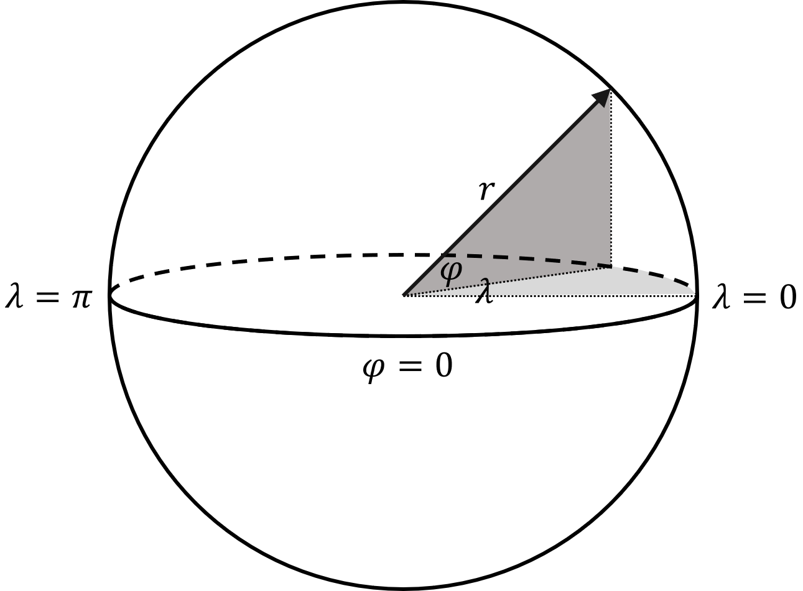

.. ------------------------------------------------------------------------------
     (c) Crown copyright Met Office. All rights reserved.
     The file LICENCE, distributed with this code, contains details of the terms
     under which the code may be used.
   ------------------------------------------------------------------------------

.. _coordinates_and_vectors_spherical_polar_coordinates:

Spherical Polar Coordinates
===========================

Spherical polar coordinates use longitude :math:`\lambda`, latitude
:math:`\varphi` and radius :math:`r`.

    Geocentric Cartesian coordinates.

    Spherical polar coordinates relative to the geocentric Cartesian system.

The transformation to spherical polar coordinates is

.. math::

    \lambda = \tan^{-1}\left(\frac{Y}{X}\right), \qquad
    \varphi = \tan^{-1}\left(\frac{Z}{\sqrt{X^2 + Y^2}}\right), \qquad
    r = \sqrt{X^2 + Y^2 + Z^2},

and the inverse mapping is

.. math::

    X = r\cos\lambda\cos\varphi, \qquad
    Y = r\sin\lambda\cos\varphi, \qquad
    Z = r\sin\varphi.

The primal and dual basis vectors are aligned because the coordinate system is
orthogonal. Writing the unit vectors in Cartesian components gives

.. math::

    \mathbf{e}_\lambda = r\cos\varphi\begin{bmatrix}-\sin\lambda\\ \cos\lambda\\ 0\end{bmatrix}, \qquad
    \mathbf{e}_\varphi = r\begin{bmatrix}-\cos\lambda\sin\varphi\\ \sin\lambda\sin\varphi\\ \cos\varphi\end{bmatrix}, \qquad
    \mathbf{e}_r = \begin{bmatrix}\cos\lambda\cos\varphi\\ \sin\lambda\cos\varphi\\ \sin\varphi\end{bmatrix}.

The corresponding Jacobian from :math:`(\lambda,\varphi,r)` to :math:`(X,Y,Z)` is

.. math::

    \mathbf{J}^{(XYZ,\lambda\varphi r)} =
    \begin{bmatrix}
    -r\sin\lambda\cos\varphi & -r\cos\lambda\sin\varphi & \cos\lambda\cos\varphi \\
     r\cos\lambda\cos\varphi & -r\sin\lambda\sin\varphi & \sin\lambda\cos\varphi \\
     0 & r\cos\varphi & \sin\varphi
    \end{bmatrix}.

